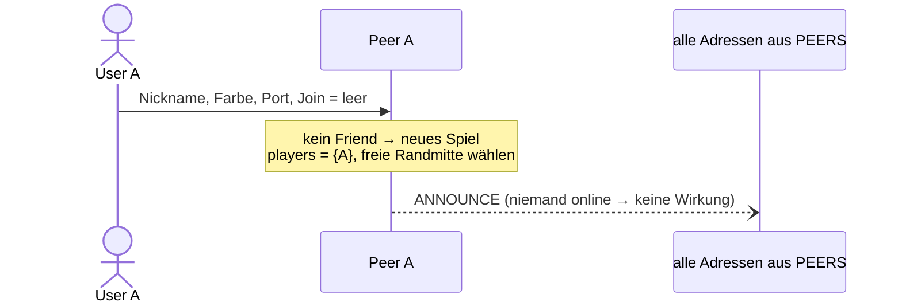
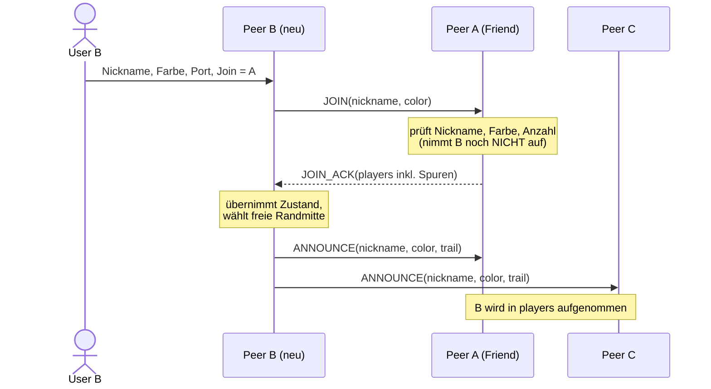
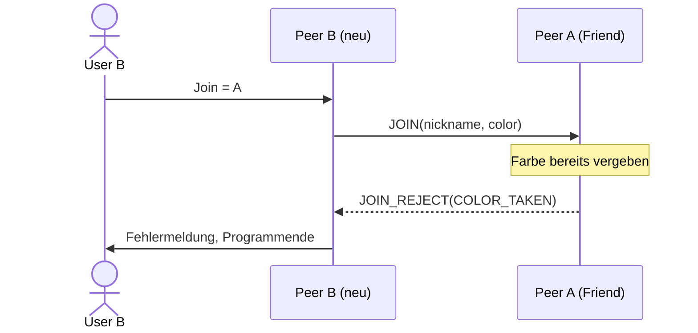
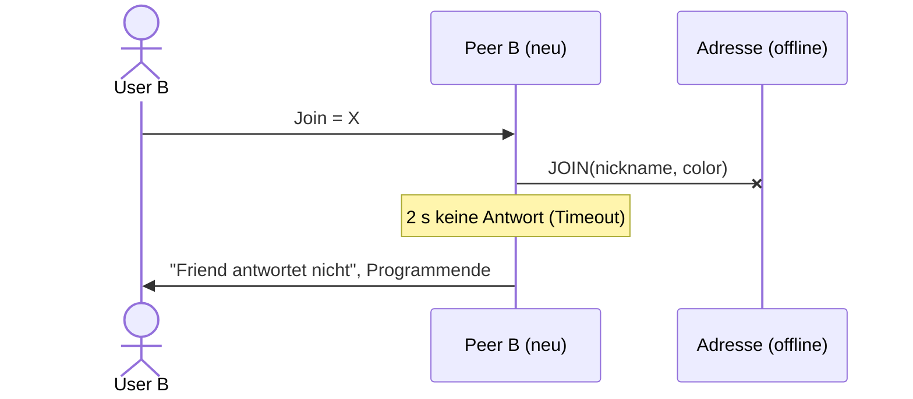
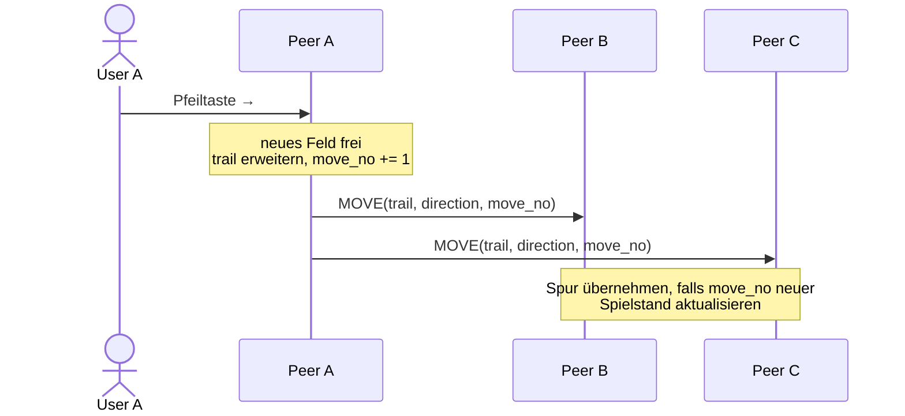
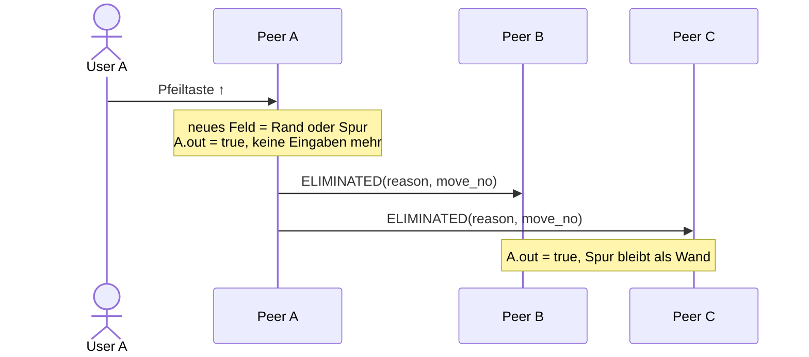
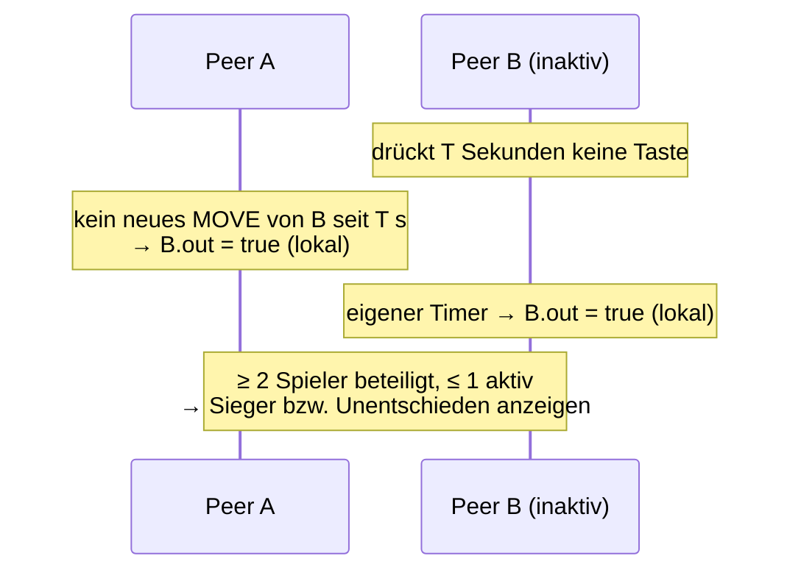

# Protokolldesign – P2P-Snake (Teil 1)

## 1. Überblick und Annahmen

- **Architektur:** Reines Peer-to-Peer. Jeder Peer hält eine vollständige Kopie des Spielzustands (Replikat).
- **Transport:** UDP. **Format:** JSON, kodiert als UTF-8.
- **Bekannte Peer-Menge:** Alle möglichen Adressen (IP:Port) sind als Konstante bekannt (`PEERS`). Nachrichten an alle gehen an jede Adresse dieser Menge, auch wenn dort niemand online ist.
- **Absenderadresse:** Wird aus dem UDP-Header entnommen (`recvfrom`). Gesendet und empfangen wird über denselben gebundenen Socket, daher stimmen Absenderport und Empfangsport überein.
- **Keine gleichzeitigen Eingaben** (laut Vereinfachung). Race Conditions werden nicht aufgelöst (siehe Abschnitt 6).

**Parameter:** Spielfeld `M × M` (`GRID_SIZE`, z. B. 25), Inaktivitätsgrenze `T` (`MAX_TIME`, 3 s), höchstens 4 Spieler.

**Zustand pro Peer:** `players` enthält einen Eintrag pro Spieler:

| Feld | Bedeutung |
|---|---|
| `ip`, `port` | Adresse des Peers |
| `nickname`, `color` | eindeutig innerhalb des Spiels |
| `trail` | Liste aller belegten Felder `[[x, y], …]`; `trail[0]` = Startposition, `trail[-1]` = aktuelle Position |
| `move_no` | Anzahl eigener Züge |
| `out` | ausgeschieden ja/nein |
| `last_move` | lokaler Zeitpunkt des letzten Zugs (für Inaktivität) |
| `out_at` | lokaler Zeitpunkt des Ausscheidens (für Rangfolge) |

**Verantwortlichkeiten:**
- Jeder Peer prüft **nur seine eigene Kollision** und meldet sie.
- **Inaktivität** und **Spielende** erkennt jeder Peer lokal, ohne Nachricht.

## 2. Nachrichtentypen

| Typ | Sender → Empfänger | Auslöser | Rolle |
|---|---|---|---|
| `JOIN` | neuer Peer → Friend | Eingabe von `IP:Port` eines Friends | Beitrittsanfrage mit Nickname und Farbe |
| `JOIN_ACK` | Friend → neuer Peer | gültiges `JOIN` | Beitritt angenommen; überträgt den **vollständigen Spielzustand** (alle Spieler inkl. Spuren) |
| `JOIN_REJECT` | Friend → neuer Peer | ungültiges `JOIN` | Beitritt abgelehnt, mit Grund |
| `ANNOUNCE` | neuer Peer → alle | nach `JOIN_ACK` bzw. Spielstart | Neuen Spieler mit Startposition bekannt machen; Empfänger nehmen ihn auf |
| `MOVE` | Spieler → alle | Pfeiltaste, kein Hindernis | Zug; enthält die **komplette Spur** |
| `ELIMINATED` | Spieler → alle | Pfeiltaste, Kollision | Ausscheiden durch Kollision melden |

## 3. Nachrichtenformat

Jede Nachricht enthält die Felder `type` (Nachrichtentyp) und `clock` (Lamport-Zeitstempel). Koordinaten sind `[x, y]` mit `0 ≤ x, y < M`; `up` erhöht `y`.

**JOIN**
```json
{ "type": "JOIN", "clock": 1, "nickname": "bob", "color": "blau" }
```

**JOIN_ACK** – `players` ist ein Objekt mit einem Eintrag pro Spieler. Die Schlüssel haben die Form `"ip_port"`, der Eintrag des Friends selbst steht unter `"me"`.
```json
{ "type": "JOIN_ACK", "clock": 5,
  "players": {
    "me": { "ip": "127.0.0.1", "port": 5000, "nickname": "alice", "color": "rot",
            "trail": [[12, 24], [12, 23]], "move_no": 1, "out": false },
    "127.0.0.1_5002": { "ip": "127.0.0.1", "port": 5002, "nickname": "carol", "color": "gruen",
            "trail": [[0, 12]], "move_no": 0, "out": false }
  } }
```

**JOIN_REJECT** – `reason` ∈ `NICKNAME_TAKEN`, `COLOR_TAKEN`, `GAME_FULL`
```json
{ "type": "JOIN_REJECT", "clock": 5, "reason": "COLOR_TAKEN" }
```

**ANNOUNCE** – `trail` enthält genau die Startposition
```json
{ "type": "ANNOUNCE", "clock": 7, "nickname": "bob", "color": "blau", "trail": [[24, 12]] }
```

**MOVE**
```json
{ "type": "MOVE", "clock": 9, "trail": [[24, 12], [23, 12]], "direction": "left", "move_no": 1 }
```

**ELIMINATED** – `reason` ∈ `WALL`, `TRAIL`
```json
{ "type": "ELIMINATED", "clock": 15, "reason": "TRAIL", "move_no": 4 }
```

## 4. Sequenzdiagramme

### a) Neues Spiel (Eingabe: Join leer)


### b) Beitritt erfolgreich (Eingabe: Join = IP:Port von A)


### c) Beitritt abgelehnt


### d) Friend nicht erreichbar


### e) Zug (Eingabe: Pfeiltaste, Feld frei)


### f) Kollision (Eingabe: Pfeiltaste, Feld belegt)


### g) Inaktivität und Spielende (keine Eingabe)


## 5. Verarbeitungsregeln

| Regel | Beschreibung |
|---|---|
| Aufnahme | Ein Spieler wird erst beim `ANNOUNCE` aufgenommen, nicht beim `JOIN`. Ein wiederholtes `JOIN` ist daher harmlos. |
| Unbekannte Absender | `MOVE`/`ELIMINATED` von unbekannten Adressen werden ignoriert. |
| Duplikate, Reihenfolge | `MOVE` wird nur übernommen, wenn `move_no` größer als der bekannte Stand ist. Da `MOVE` die komplette Spur enthält, gleicht das nächste `MOVE` ein verlorenes aus. |
| Ausgeschiedene | Nachrichten eines ausgeschiedenen Spielers ändern seinen Zustand nicht mehr. Seine Spur bleibt als Wand bestehen. |
| Inaktivität | Spieler mit `now − last_move > T` gelten als ausgeschieden. Das deckt auch abgestürzte Peers und verlorene `ELIMINATED` ab. |
| Spielende | Mindestens 2 Spieler beteiligt und höchstens 1 aktiv. Danach keine Züge und keine Inaktivitätsprüfung mehr. |
| Rangfolge | Aktive Spieler vorne, danach Ausgeschiedene absteigend nach `out_at`. |

## 6. Lamport-Uhr

Jeder Peer führt eine logische Uhr: `clock += 1` vor jedem Senden, `clock = max(clock, msg.clock) + 1` bei jedem Empfang. `(clock, port)` liefert eine auf allen Peers identische totale Ordnung.

Die Uhr wird mitgeführt, aber **nicht ausgewertet**, da gleichzeitige Eingaben laut Vereinfachung ausgeschlossen sind. Sie ist vorbereitet für:
- **Optionale Anforderung 21:** Ziehen zwei Spieler nahezu gleichzeitig auf dasselbe Feld, gilt der Zug mit kleinerem `(clock, port)` als gültig, der andere als Kollision.
- **Konsistente Rangfolge:** Sortierung nach dem `clock` der `ELIMINATED`-Nachricht statt nach lokaler Empfangszeit.

## 7. Bekannte Einschränkungen

- Ein verlorenes `JOIN` oder `JOIN_ACK` wird nicht wiederholt. Nach dem Timeout bricht der Join ab und muss neu gestartet werden.
- Starten zwei Peers gleichzeitig ohne Friend, entstehen zwei getrennte Spiele (Split Brain).
- Inaktivität und Rangfolge beruhen auf lokalen Zeitpunkten und können sich zwischen Peers geringfügig unterscheiden.