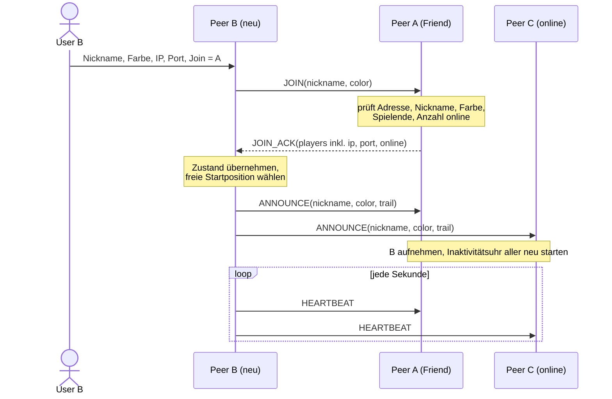
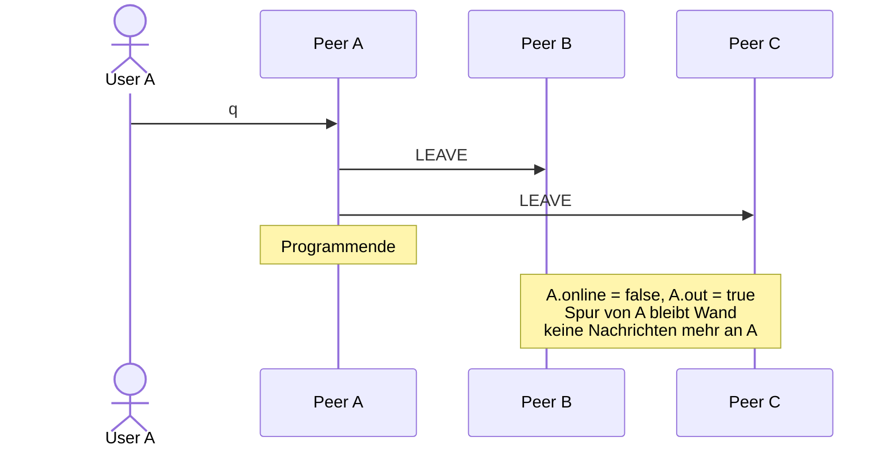
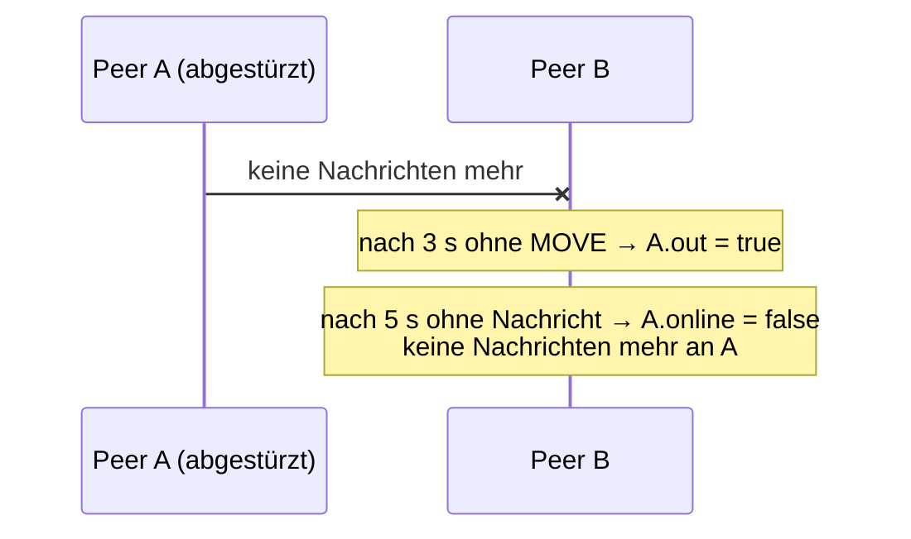
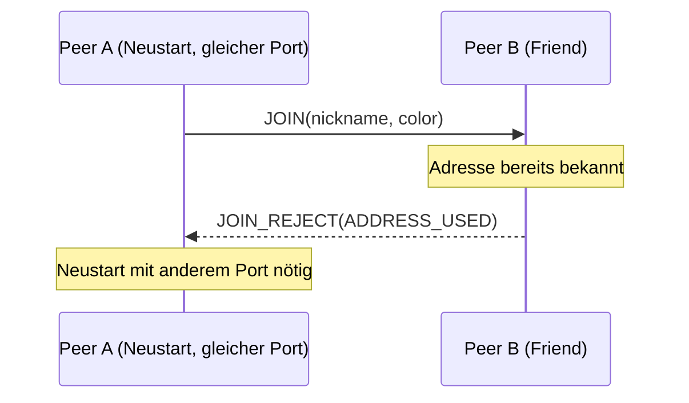

# Protokolldesign – P2P-Snake (Teil 2: Gruppenmanagement)

Dieses Dokument beschreibt die Erweiterungen gegenüber Teil 1. Nachrichtentypen und Regeln aus Teil 1 gelten weiter, sofern hier nichts anderes steht.

## 1. Neue Anforderungen und Folgen

| Nr. | Anforderung | Umsetzung |
|---|---|---|
| 4a | Die Obermenge möglicher Peers ist **unbekannt**; Peers kommen und gehen jederzeit | Die feste Peer-Liste entfällt. Jeder Peer kennt nur die Mitglieder aus `players`, die er über `JOIN_ACK` und `ANNOUNCE` erfährt. |
| 4b | Ein neuer Peer erfährt, wer in der Gruppe ist; Nachrichten nur an **Online-Peers** | `JOIN_ACK` enthält alle Spieler inkl. Adresse und Online-Status. Gesendet wird nur an Spieler mit `online = true`. |
| 4c | `Leave`-Kommando; die Spur bleibt bestehen | Neuer Nachrichtentyp `LEAVE` (Taste `q`). Der Eintrag bleibt erhalten, die Spur bleibt Wand. |
| 4d | Online-Teilnehmer werden im Spielstand angezeigt | Feld `online` pro Spieler; Erkennung per `HEARTBEAT` und Timeout. |

## 2. Zusätzliche Protokollelemente

1. **Dynamische Mitgliederliste** (`players`) ersetzt die konstante Peer-Liste.
2. **Online-Status** pro Spieler (`online`, `last_seen`).
3. **`HEARTBEAT`:** Lebenszeichen jede Sekunde.
4. **`LEAVE`:** Abmeldung beim Verlassen.
5. **Online-Timeout:** Wer 5 s lang keine Nachricht sendet, gilt als offline (z. B. nach einem Absturz).
6. **Neue Ablehnungsgründe** für `JOIN`: `ADDRESS_USED`, `GAME_OVER`.

## 3. Parameter und Zustand

| Parameter | Wert | Bedeutung |
|---|---|---|
| `GRID_SIZE` | 25 | Spielfeld M × M |
| `MAX_TIME` | 3 s | Inaktivität → ausgeschieden (Anforderung 6) |
| `HEARTBEAT_INTERVAL` | 1 s | Abstand der Heartbeats |
| `ONLINE_TIMEOUT` | 5 s | ohne jede Nachricht → offline |
| `MAX_PLAYERS` | 4 | maximale Anzahl gleichzeitig online |

Der Eintrag pro Spieler in `players` (Schlüssel `"me"` für den eigenen Spieler, sonst `"ip_port"`):

| Feld | Bedeutung |
|---|---|
| `ip`, `port` | Adresse des Peers |
| `nickname`, `color` | eindeutig innerhalb des Spiels |
| `trail` | alle belegten Felder `[[x, y], …]` |
| `move_no` | Anzahl eigener Züge |
| `out`, `out_at` | ausgeschieden ja/nein, lokaler Zeitpunkt |
| `last_move` | lokaler Zeitpunkt des letzten Zugs → Inaktivität |
| **`online`** | Peer ist erreichbar und Mitglied der Gruppe (neu) |
| **`last_seen`** | lokaler Zeitpunkt der letzten Nachricht beliebigen Typs → Online-Status (neu) |

**Unterscheidung:** *ausgeschieden* (`out`) betrifft das Spiel, *offline* (`online = false`) betrifft die Gruppe. Ein ausgeschiedener Spieler kann weiter online sein, ein Spieler, der die Gruppe verlassen hat, ist immer auch ausgeschieden.

**Adressen:** Jeder Peer gibt beim Start seine IP ein (Vorschlag: LAN-IP) und bindet an `0.0.0.0:<port>`. Der Schlüssel `"ip_port"` wird aus der Absenderadresse des UDP-Headers gebildet. Alle Peers müssen daher dieselbe Art von Adresse verwenden (lokal: `127.0.0.1`, im LAN: die LAN-IP).

## 4. Nachrichtentypen

| Typ | Sender → Empfänger | Auslöser | Rolle |
|---|---|---|---|
| `JOIN` | neu → Friend | Kommando `Join IP:Port` | Beitrittsanfrage (unverändert) |
| `JOIN_ACK` | Friend → neu | gültiges `JOIN` | vollständiger Zustand **inkl. Adressen und Online-Status** |
| `JOIN_REJECT` | Friend → neu | ungültiges `JOIN` | Ablehnung mit Grund (neue Gründe) |
| `ANNOUNCE` | neu → alle Online-Mitglieder | nach `JOIN_ACK` | neuen Spieler bekannt machen |
| `MOVE` | Spieler → alle Online-Mitglieder | Pfeiltaste | Zug (unverändert) |
| `ELIMINATED` | Spieler → alle Online-Mitglieder | Kollision | Ausscheiden (unverändert) |
| **`HEARTBEAT`** | Peer → alle Online-Mitglieder | jede Sekunde | Lebenszeichen (neu) |
| **`LEAVE`** | Peer → alle Online-Mitglieder | Taste `q`, Programmende | Gruppe verlassen (neu) |

## 5. Nachrichtenformat

Jede Nachricht enthält `type` und `clock` (Lamport-Zeitstempel). Die Absenderadresse kommt aus dem UDP-Header.

**JOIN_ACK** – `players` ist ein Objekt; der Eintrag des Friends steht unter `"me"`, alle anderen unter `"ip_port"`.
```json
{ "type": "JOIN_ACK", "clock": 12,
  "players": {
    "me": { "ip": "192.168.1.10", "port": 5000, "nickname": "alice", "color": "rot",
            "trail": [[12, 24], [12, 23]], "move_no": 1, "out": false, "online": true },
    "192.168.1.12_5000": { "ip": "192.168.1.12", "port": 5000, "nickname": "carol", "color": "gruen",
            "trail": [[0, 12], [1, 12]], "move_no": 1, "out": true, "online": false }
  } }
```

**JOIN_REJECT** – `reason` ∈ `ADDRESS_USED`, `NICKNAME_TAKEN`, `COLOR_TAKEN`, `GAME_OVER`, `GAME_FULL`
```json
{ "type": "JOIN_REJECT", "clock": 12, "reason": "ADDRESS_USED" }
```

**HEARTBEAT**
```json
{ "type": "HEARTBEAT", "clock": 20 }
```

**LEAVE**
```json
{ "type": "LEAVE", "clock": 31 }
```

`JOIN`, `ANNOUNCE`, `MOVE` und `ELIMINATED` sind unverändert gegenüber Teil 1.

## 6. Verarbeitungsregeln

| Ereignis | Verarbeitung |
|---|---|
| **Jede** Nachricht von bekanntem Absender | `online = true`, `last_seen = now` |
| `HEARTBEAT` | keine weitere Verarbeitung |
| `LEAVE` | `online = false`; falls noch im Spiel: `out = true`, `out_at = now`. Spur bleibt. |
| `now − last_seen > 5 s` | `online = false` |
| `now − last_move > 3 s` (ab 2 Spielern, vor Spielende) | `out = true` (Anforderung 6) |
| `ANNOUNCE` | neuen Spieler aufnehmen; Inaktivitätsuhr (`last_move`) **aller** Spieler neu starten, damit niemand beim Beitritt sofort ausscheidet |
| `JOIN_ACK` | alle Spieler übernehmen; `last_move` und `last_seen` auf lokale Zeit setzen |
| Senden | nur an Spieler mit `online = true` |

**Prüfung beim `JOIN` (in dieser Reihenfolge):**
1. Adresse ist bereits bekannt → `ADDRESS_USED`
2. Nickname vergeben (auch von Spielern, die gegangen sind) → `NICKNAME_TAKEN`
3. Farbe vergeben (auch von Spielern, die gegangen sind) → `COLOR_TAKEN`
4. Spiel bereits beendet → `GAME_OVER`
5. bereits 4 Spieler online → `GAME_FULL`

Der neue Spieler wird beim `JOIN` **nicht** aufgenommen, sondern erst beim `ANNOUNCE`.

**Startposition:** zufällig eine freie Randmitte; sind alle belegt, ein beliebiges freies Randfeld (frei = von keiner Spur belegt).

## 7. Sequenzdiagramme

### a) Beitritt mit Mitgliederliste


### b) Verlassen der Gruppe (Taste q)


### c) Absturz eines Peers


### d) Erneuter Beitritt mit gleicher Adresse


## 8. Anzeige (Anforderung 4d)

```text
 Rang  Spieler              Züge  Status          Online
  1.   ■ alice (du)           12  im Spiel        ja
  1.   ■ bob                   9  im Spiel        ja
  3.   ■ carol                 5  ausgeschieden   nein
```

## 9. Lamport-Uhr

Wie in Teil 1: `clock += 1` vor jedem Senden, `clock = max(clock, msg.clock) + 1` bei jedem Empfang, auch bei `HEARTBEAT` und `LEAVE`. Die Uhr misst keine Zeit, sondern legt nur die kausale Reihenfolge fest. Zusätzliche Heartbeats verfälschen sie daher nicht. Sie gleichen die Uhren der Peers sogar regelmäßig an. Die Uhr wird mitgeführt, aber nicht ausgewertet (siehe Teil 1).

## 10. Einschränkungen

- **Wiederbeitritt** ist nur mit einem neuen Port möglich. Nickname und Farbe von Spielern, die gegangen sind, bleiben reserviert, da ihre Spur bestehen bleibt.
- **Nach Spielende** werden keine Beitritte mehr angenommen. Für eine neue Runde starten alle Peers neu.
- **Verlorene Nachrichten** werden nicht wiederholt. Ein verlorenes `ANNOUNCE` führt dazu, dass ein Peer den neuen Spieler nicht kennt. Ein verlorenes `LEAVE` wird durch den Online-Timeout ausgeglichen.
- **Online-Status, Inaktivität und Rangfolge** beruhen auf lokalen Zeitpunkten und können sich zwischen Peers kurzzeitig unterscheiden.
- **Gleichzeitige Beitritte** über verschiedene Friends werden nicht koordiniert (Vereinfachung: keine gleichzeitigen Eingaben).
- **Firewall:** Der eigene UDP-Port muss freigeschaltet sein: `sudo firewall-cmd --add-port=<port>/udp`.