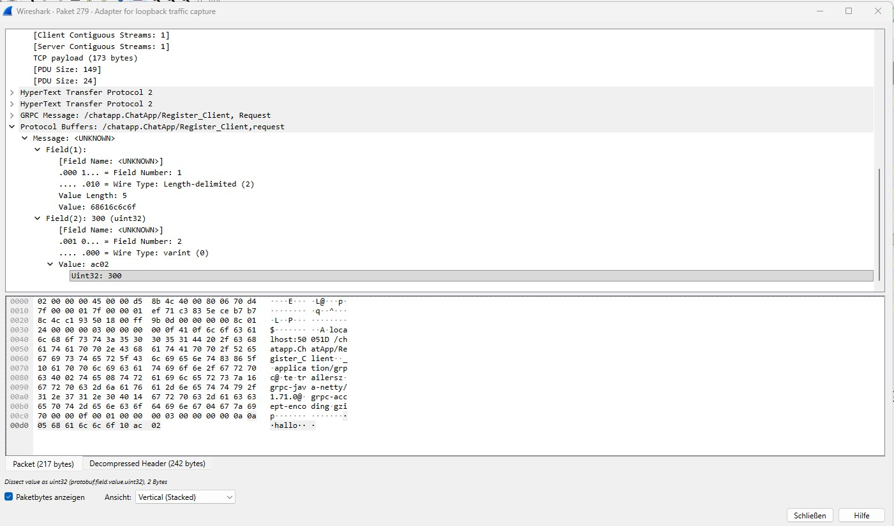

## Abschnitt 2: Analyse

### Übersicht der übertragenen gRPC-/Protobuf-Nachricht

In Wireshark wurde das Aufrufen der RPC-Methode `Register_Client` mit einer `Client`-Nachricht (`nickname = "hallo"`, `zahl = 300`) mitgeschnitten.

**Vollständiger gRPC-Frame (Hex):**
`00 00 00 00 0a 0a 05 68 61 6c 6c 6f 10 ac 02`

* **`00`**: gRPC Compression-Flag (`0` = unkomprimiert)
* **`00 00 00 0a`**: Länge der nachfolgenden Protobuf-Nachricht (`10 Bytes`)
* **`0a 05 68 61 6c 6c 6f 10 ac 02`**: Eigentliche Protobuf-Payload (`10 Bytes`)

---

### Feld 1 (String-Typ)

* **Feldname (aus proto-File):** `nickname` (Feldnummer `1`, Typ `string` in `message Client`)
* **Binärcode (in hex):** `0a 05 68 61 6c 6c 6f`

**Analyse (wie dekodieren sich die Hexwerte zu einem Inhalt):**

1. **Field-Tag (`0a`):**
   * Hex `0x0A` entspricht dezimal `10` bzw. binär `0000 1010`.
   * Das MSB (höchstwertiges Bit) ist `0` $\rightarrow$ das Tag besteht aus nur einem Byte.
   * Die unteren 3 Bits (`010`₂ = `2`) geben den **Wire-Type `2` (`LEN` – Length-Delimited)** an, der in Protobuf für Strings verwendet wird.
   * Die verbleibenden oberen Bits (`0001`₂ = `1`) ergeben die **Feldnummer `1`** (`nickname`).

2. **Längenangabe (`05`):**
   * Bei Wire-Type `2` folgt direkt nach dem Tag die Byte-Länge des Inhalts als Varint.
   * Hex `0x05` entspricht dezimal **`5`** $\rightarrow$ der nachfolgende String ist **5 Bytes** lang.

3. **Nutzdaten / Inhalt (`68 61 6c 6c 6f`):**
   * Die nächsten 5 Bytes werden als UTF-8-/ASCII-Zeichen dekodiert:
     * `0x68` = `'h'`
     * `0x61` = `'a'`
     * `0x6c` = `'l'`
     * `0x6c` = `'l'`
     * `0x6f` = `'o'`
   * **Dekodierter Inhalt:** `"hallo"`

---

### Feld 2 (Integer-Typ)

* **Feldname (aus proto-File):** `zahl` (Feldnummer `2`, Typ `int32` in `message Client`)
* **Binärcode (in hex):** `10 ac 02`

**Analyse (wie dekodieren sich die Hexwerte zu einem Inhalt):**

1. **Field-Tag (`10`):**
   * Hex `0x10` entspricht dezimal `16` bzw. binär `0001 0000`.
   * Das MSB ist `0` $\rightarrow$ ein Byte für das Tag.
   * Die unteren 3 Bits (`000`₂ = `0`) geben den **Wire-Type `0` (`VARINT`)** an, der für `int32` verwendet wird.
   * Die oberen Bits (`0010`₂ = `2`) ergeben die **Feldnummer `2`** (`zahl`).

2. **Varint-Nutzdaten (`ac 02`):**
   * Varints werden in 7-Bit-Blöcken im **Little-Endian-Format** übertragen, wobei das MSB jedes Bytes als Continuation-Bit dient (`1` = weiteres Byte folgt, `0` = letztes Byte).
   * **1. Byte (`0xAC`):** Binär `1010 1100`
     * MSB = `1` (es folgt noch ein Byte)
     * Untere 7 Bits (Nutzdaten): `0101100`₂
   * **2. Byte (`0x02`):** Binär `0000 0010`
     * MSB = `0` (letztes Byte des Varints)
     * Untere 7 Bits (Nutzdaten): `0000010`₂
   * **Zusammensetzen (Little-Endian umkehren, oberes Byte nach vorne):**
     $$\text{Binär: } \mathbf{0000010}\,\mathbf{0101100}_2 = 100101100_2$$
     $$\text{Dezimal: } 256 + 32 + 8 + 4 = \mathbf{300}$$
   * **Dekodierter Inhalt:** `300`

## Anhang
