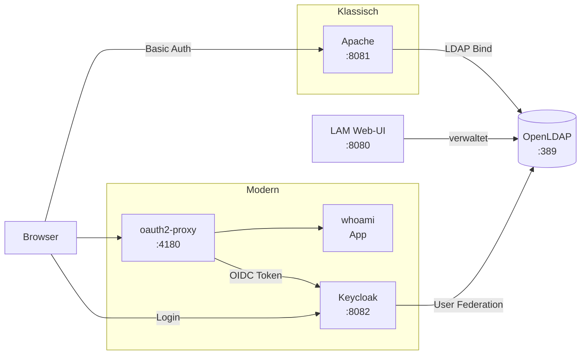
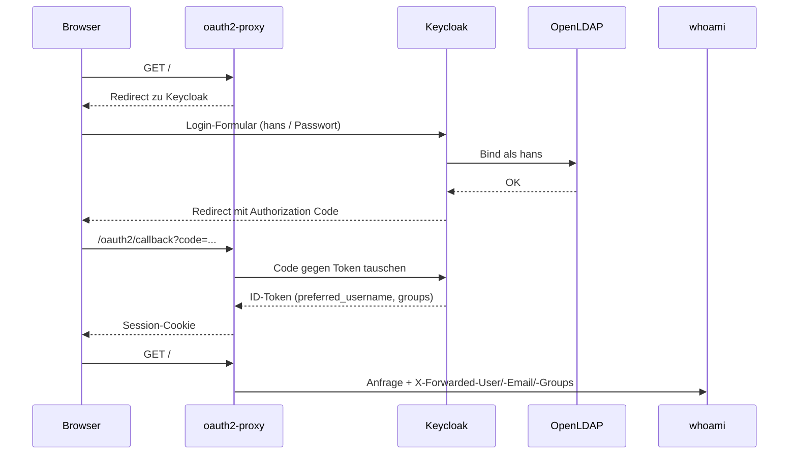

# LDAP-Testlab

Lokales Setup, um LDAP als zentralen Verzeichnisdienst kennenzulernen. Es zeigt zwei Wege, Anwendungen daran anzubinden:

1. **Klassisch:** Apache prüft Benutzer direkt gegen LDAP (HTTP Basic Auth).
2. **Modern:** Keycloak nutzt LDAP als Benutzerquelle, und Anwendungen melden sich per **OpenID Connect** an.

## Architektur



## Dienste

| Dienst | URL | Login | Zweck |
|---|---|---|---|
| OpenLDAP | `ldap://localhost:389` | `cn=admin,dc=testlab,dc=local` / `adminpass` | Verzeichnisdienst |
| LAM | http://localhost:8080 | `admin` / `adminpass` (Master-Passwort für die Konfiguration: `lam`) | Web-UI zum Anlegen von Benutzern und Gruppen |
| Apache | http://localhost:8081 | LDAP-Benutzer | Basic Auth direkt gegen LDAP |
| Keycloak | http://localhost:8082 | `admin` / `admin` | Identity Provider, Realm `testlab` |
| oauth2-proxy + whoami | http://localhost:4180 | LDAP-Benutzer (über Keycloak) | Per OIDC geschützte Test-App |

## Starten

```bash
docker compose up -d
```

Keycloak braucht ungefähr 30 Sekunden zum Starten. Beim Start wird der Realm aus [keycloak/realm-testlab.json](keycloak/realm-testlab.json) importiert.

## Aktueller Stand des Verzeichnisses

```
dc=testlab,dc=local
├── cn=admin           (LDAP-Admin)
├── cn=hans            (posixAccount, inetOrgPerson, uid=hans)
└── cn=testgroup       (posixGroup, noch ohne memberUid)
```

Benutzer und Gruppen liegen direkt unter der Wurzel. Üblich wäre eine Gliederung in `ou=people` und `ou=groups`.

Verzeichnis anzeigen:

```bash
docker exec ldap-server ldapsearch -x -H ldap://localhost \
  -D "cn=admin,dc=testlab,dc=local" -w adminpass -b dc=testlab,dc=local -LLL
```

## Variante 1: Apache mit LDAP (Basic Auth)

Konfiguration: [ldap-auth.conf](ldap-auth.conf)

1. Apache meldet sich als Admin am LDAP an und sucht ab der Wurzel nach `uid=<benutzer>`.
2. Mit dem gefundenen DN und dem eingegebenen Passwort meldet er sich ein zweites Mal an (Bind). Klappt das, ist der Benutzer authentifiziert.

```bash
curl -u hans:<passwort> localhost:8081
```

Eine Konfiguration, die nur Mitglieder von `testgroup` zulässt, steht auskommentiert in der Datei.

> Hinweis: Über das Port-Forwarding der Coder-VM zeigt der Browser keine Passwortabfrage an, deshalb mit `curl` direkt auf der VM testen.

## Variante 2: Keycloak + OIDC



Öffne http://localhost:4180 und melde dich mit einem LDAP-Benutzer an. `whoami` zeigt dir dann die Header, die es von oauth2-proxy bekommt.

**Was im Realm `testlab` eingerichtet ist** ([realm-testlab.json](keycloak/realm-testlab.json)):

- **User Federation `openldap`:** Keycloak liest Benutzer (`posixAccount`, Login über `uid`) und Gruppen (`posixGroup`, Mitglieder über `memberUid`) aus dem LDAP. Es greift nur lesend zu (`READ_ONLY`), Passwörter werden weiterhin im LDAP geprüft.
- **Client `oauth2-proxy`:** Ein vertraulicher Client mit dem Secret `oauth2-proxy-secret`. Er schreibt die Gruppen des Benutzers in das Token (Claim `groups`).

**Hostnamen:** Der Browser erreicht Keycloak unter `localhost:8082`, die anderen Container unter `keycloak:8080`. Deshalb gilt:
- In Keycloak ist `KC_HOSTNAME=http://localhost:8082` gesetzt, damit die Tokens immer dieselbe Herausgeber-Adresse (Issuer) enthalten.
- oauth2-proxy liest die Keycloak-Adressen nicht automatisch aus (`--skip-oidc-discovery`). Die Login-Adresse für den Browser und die internen Adressen für Token und Schlüssel sind einzeln eingetragen.

**Nur bestimmte Gruppen zulassen:** In LAM den Benutzer in `testgroup` aufnehmen und in [docker-compose.yaml](docker-compose.yaml) bei oauth2-proxy `--allowed-group=testgroup` ergänzen.

## Sicherheit

Das hier ist ein **reines Testsetup**: Alle Passwörter, Client-Secrets und das Cookie-Secret stehen im Klartext in den Dateien, LDAP läuft ohne TLS, und Keycloak läuft im Entwicklungsmodus (`start-dev`). Nichts davon für den echten Betrieb übernehmen.

## Ideen für die nächsten Schritte

- Gliederung mit `ou=people` und `ou=groups` anlegen
- LDAPS / StartTLS aktivieren
- Gruppenbasierten Zugriff in oauth2-proxy ausprobieren
- Zwei-Faktor-Login (TOTP) im Realm aktivieren
- Eine zweite Anwendung anbinden und Single Sign-On zwischen beiden testen
